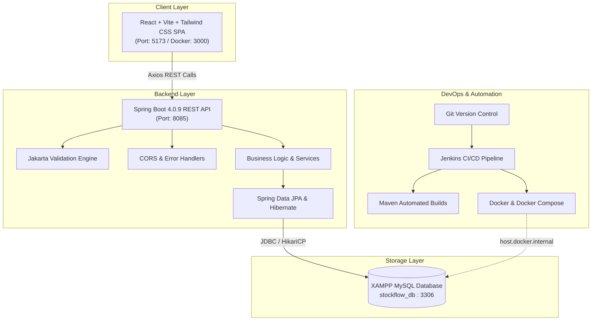

# StockFlow – Smart Inventory & Order Management System

[](https://www.oracle.com/java/)
[](https://spring.io/projects/spring-boot)
[](https://react.dev/)
[](https://vitejs.dev/)
[](https://tailwindcss.com/)
[](https://www.apachefriends.org/)
[](https://www.docker.com/)
[](https://www.jenkins.io/)

StockFlow is a production-grade, full-stack inventory and order management system built with **Java 21, Spring Boot 4.0.9, React, Vite, Tailwind CSS, XAMPP MySQL, Docker, and Jenkins CI/CD**. Designed for modern warehouse management, StockFlow delivers automated inventory auditing, safety-stock alerting, multi-item order fulfillment, and negative inventory prevention.

---

## Architecture Overview



---

## Key Features

### 1. Product & Catalog Management
- Unique SKU tracking code validation.
- Category assignment with cascading referential integrity protection.
- Pricing, warehouse quantity, and customizable minimum low-stock thresholds.
- Safe deletion validation: prevents deleting products referenced in sales orders.

### 2. Category Hierarchy
- Unique category naming with full validation.
- Product count aggregation per category.
- Deletion barrier: blocks category removal if active products are associated.

### 3. Inventory & Stock Audit Ledger
- **Inbound Stock:** Add new stock batches with supplier notes.
- **Outbound Stock:** Remove damaged or transferred units.
- **Zero-Negative Protection:** Enforces strict non-negative inventory balances at the database and service layer.
- **Audit History:** Immutable chronological log of every stock movement (`IN`, `OUT`, `ADJUSTMENT`) with timestamps and before/after balances.
- **Safety Stock Alerts:** Instant visual indicators and alerts for low-stock items.

### 4. Order Processing Engine
- Multi-product line item orders with live subtotal calculation.
- Automated pre-flight stock availability verification.
- Instant stock deduction upon order creation.
- Lifecycle tracking: `PENDING` $\rightarrow$ `PROCESSING` $\rightarrow$ `COMPLETED` $\rightarrow$ `CANCELLED`.
- **Automated Stock Restoration:** When an order is cancelled, all items are automatically restored to the warehouse and audited.

### 5. Executive Dashboard
- Real-time KPI summary cards (Products, Categories, Orders, Total Units, Low-Stock Alerts, Active Revenue).
- Critical low-stock warning banners with one-click restock actions.
- Split-pane live feeds of recent orders and inventory audit events.

---

## Technology Stack

| Layer | Technology | Version | Purpose |
| :--- | :--- | :--- | :--- |
| **Backend** | Java | 21 LTS | Core runtime |
| **Framework** | Spring Boot | 4.0.9 / 4.1 | Application framework |
| **Data Access** | Spring Data JPA / Hibernate | 7.2 | ORM and persistence |
| **Database** | XAMPP MySQL / MariaDB | 10.4 | Relational storage (localhost:3306) |
| **Validation** | Jakarta Validation | 3.1 | Request data validation |
| **Frontend** | React | 19 | Single Page Application (SPA) |
| **Build Tool** | Vite | 8 | Blazing fast frontend bundling |
| **Styling** | Tailwind CSS | 4 | Modern utility-first CSS |
| **Routing** | React Router | 7 | Client-side page navigation |
| **HTTP Client** | Axios | 1.8 | REST API consumption |
| **Icons** | Lucide React | 1.x | Crisp dashboard iconography |
| **Container** | Docker & Compose | Multi-stage | Containerization & orchestration |
| **CI/CD** | Jenkins | LTS | Automated build, test, and container pipeline |

---

## Project Structure

```text
StockFlow/
├── backend/
│   ├── src/
│   │   ├── main/
│   │   │   ├── java/com/stockflow/stockflow/
│   │   │   │   ├── config/              # WebConfig (CORS), DataInitializer
│   │   │   │   ├── controller/          # REST Controllers (Dashboard, Products, Categories, Inventory, Orders)
│   │   │   │   ├── dto/                 # Request & Response Data Transfer Objects
│   │   │   │   ├── entity/              # JPA Entities (Category, Product, StockMovement, Order, OrderItem)
│   │   │   │   │   └── enums/           # OrderStatus, StockMovementType
│   │   │   │   ├── exception/           # GlobalExceptionHandler & Custom Exceptions
│   │   │   │   ├── repository/          # Spring Data JPA Repositories
│   │   │   │   ├── service/             # Transactional Business Logic Services
│   │   │   │   └── StockflowApplication.java
│   │   │   └── resources/
│   │   │       └── application.properties # Datasource, JPA, & Server configurations
│   │   └── test/                        # Automated unit and integration tests (9 tests)
│   ├── Dockerfile                       # Multi-stage Java 21 container specification
│   ├── pom.xml                          # Maven build dependencies
│   ├── run.bat                          # One-click Windows runner
│   └── mvnw.cmd                         # Maven Wrapper for Windows
├── frontend/
│   ├── src/
│   │   ├── api/                         # Axios client and API methods
│   │   ├── components/                  # Sidebar, Navbar, Modal, ConfirmModal, StatCard, Badge, Notification
│   │   ├── pages/                       # Dashboard, Products, Categories, Inventory, Orders
│   │   ├── App.jsx                      # Main routing & layout controller
│   │   ├── index.css                    # Tailwind CSS configuration
│   │   └── main.jsx
│   ├── Dockerfile                       # Production Nginx container build
│   ├── nginx.conf                       # SPA routing reverse proxy config
│   ├── package.json
│   └── vite.config.js
├── scripts/
│   └── test-api.ps1                     # Automated end-to-end PowerShell API test suite
├── docker-compose.yml                   # Multi-service stack definition
├── Jenkinsfile                          # 7-stage CI/CD pipeline
├── .env.example                         # Environment configuration template
├── .gitignore
└── README.md
```

---

## Getting Started

### Prerequisites

Ensure the following tools are installed on your machine:
- **Windows 11**
- **Java 21 LTS** (`java -version`)
- **Node.js 20+** and **npm** (`node -v`, `npm -v`)
- **XAMPP** (with Apache and MySQL services)
- **Git** (`git --version`)
- **Docker Desktop** *(Optional for Phase 8)*
- **Jenkins** *(Optional for Phase 9)*

---

### Step 1: Database Setup (XAMPP MySQL)

1. Open **XAMPP Control Panel** as Administrator.
2. Click **Start** next to **MySQL** (ensure port 3306 is green).
3. Open `http://localhost/phpmyadmin` in your browser.
4. Verify or create database: `stockflow_db` (collation: `utf8mb4_unicode_ci`).
5. Default credentials:
   - Host: `localhost`
   - Port: `3306`
   - Username: `root`
   - Password: *(empty)*

---

### Step 2: Backend Setup & Execution

1. Open a terminal in `backend/`:
   ```powershell
   cd backend
   ```
2. Run backend tests to verify database connectivity:
   ```powershell
   .\mvnw.cmd test
   ```
   *(All 9 tests should pass with `BUILD SUCCESS`)*
3. Start the Spring Boot backend server:
   ```powershell
   .\run.bat
   ```
   The backend will start on **http://localhost:8085** and automatically seed initial sample data.

---

### Step 3: Frontend Setup & Execution

1. Open a second terminal in `frontend/`:
   ```powershell
   cd frontend
   ```
2. Install frontend dependencies:
   ```powershell
   npm install
   ```
3. Start the Vite React development server:
   ```powershell
   npm run dev
   ```
4. Open **http://localhost:5173** in your browser.

---

### Step 4: Automated REST API Verification

To run the automated verification script that tests product creation, inventory addition, order fulfillment, stock reduction, order cancellation, stock restoration, and negative inventory prevention:

```powershell
powershell -ExecutionPolicy Bypass -File .\scripts\test-api.ps1
```

---

## REST API Reference

| Method | Endpoint | Description |
| :--- | :--- | :--- |
| **GET** | `/api/dashboard/stats` | Retrieve aggregated KPIs, recent orders, and stock movements |
| **GET** | `/api/products` | Query products (supports `keyword`, `categoryId`, `lowStockOnly`) |
| **GET** | `/api/products/{id}` | Retrieve individual product details |
| **GET** | `/api/products/low-stock` | Retrieve products below safety threshold |
| **POST** | `/api/products` | Create a new product (validates unique SKU) |
| **PUT** | `/api/products/{id}` | Update product details |
| **DELETE** | `/api/products/{id}` | Delete product (blocks if referenced in orders) |
| **GET** | `/api/categories` | Retrieve all categories with product counts |
| **POST** | `/api/categories` | Create category (validates unique name) |
| **PUT** | `/api/categories/{id}` | Update category |
| **DELETE** | `/api/categories/{id}` | Delete category (blocks if products are linked) |
| **POST** | `/api/inventory/{productId}/add` | Add stock units (creates audit log) |
| **POST** | `/api/inventory/{productId}/remove` | Remove stock units (prevents negative balance) |
| **GET** | `/api/inventory/movements` | Query full movement audit log (optional `productId`) |
| **GET** | `/api/orders` | Retrieve orders (optional `status` filter) |
| **GET** | `/api/orders/{id}` | Retrieve order details and items |
| **POST** | `/api/orders` | Place multi-item order (verifies & reduces stock) |
| **PATCH** | `/api/orders/{id}/status` | Update status (cancelling restores inventory) |

---

## Docker Containerization

StockFlow is containerized with multi-stage Docker builds. The backend container is configured to connect to your local host machine's XAMPP MySQL via `host.docker.internal`.

### Running with Docker Compose

1. Ensure XAMPP MySQL is running on your Windows host.
2. Build and start containers:
   ```powershell
   docker compose up --build -d
   ```
3. Access services:
   - **Frontend UI:** `http://localhost:3000`
   - **Backend API:** `http://localhost:8085`
4. Stop containers:
   ```powershell
   docker compose down
   ```

---

## Jenkins CI/CD Pipeline

The project includes a declarative `Jenkinsfile` with 7 stages:
1. **Checkout Source:** Pulls latest code from Git.
2. **Build Backend:** Runs Maven compilation.
3. **Run Backend Tests:** Executes automated JUnit and integration tests.
4. **Install Frontend Dependencies:** Runs `npm ci`.
5. **Build React Frontend:** Compiles production bundle with Vite.
6. **Build Docker Images:** Builds backend and frontend container images.
7. **Deploy Stack:** Starts or updates containers using `docker compose`.

### Setting Up Jenkins on Windows

1. Install Jenkins on Windows or run Jenkins in Docker:
   ```powershell
   docker run -d -p 8080:8080 -p 50000:50000 --name jenkins -v jenkins_home:/var/jenkins_home jenkins/jenkins:lts
   ```
2. Navigate to `http://localhost:8080` and complete the initial setup wizard.
3. Install recommended plugins (`Git`, `Pipeline`, `NodeJS`, `Docker Pipeline`).
4. Configure Tools (**Manage Jenkins** $\rightarrow$ **Tools**):
   - **JDK:** Name `JDK-21`, configure path to JDK 21.
   - **Maven:** Name `Maven-3`, install automatically or configure Maven path.
   - **NodeJS:** Name `NodeJS-22`, install NodeJS 20+.
5. Create a new Pipeline job:
   - Click **New Item** $\rightarrow$ Name: `StockFlow-Pipeline` $\rightarrow$ Select **Pipeline**.
   - Under **Pipeline Definition**, select **Pipeline script from SCM** $\rightarrow$ **Git**.
   - Enter your repository URL.
   - Set script path to `Jenkinsfile`.
6. Click **Build Now** to execute the pipeline.

---

## Future Enhancements

- Role-Based Access Control (Admin, Warehouse Staff, Auditor).
- Barcode and QR code scanning for stock intake via mobile device camera.
- Email and webhook notifications when critical stock thresholds are breached.
- CSV and PDF export of inventory audit logs and sales invoices.
- Supplier management and automated Purchase Order (PO) generation.

---

## License

This project is licensed under the MIT License - open for personal, academic, and commercial evaluation.
